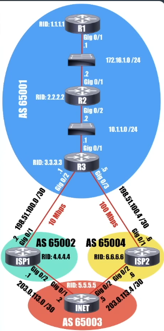

# Topology




# ISP1 Config

```bash
enable
configure terminal

hostname ISP1

!
! Router identification
!
interface Loopback0
 description ISP1-BGP-ROUTER-ID
 ip address 4.4.4.4 255.255.255.255
!
! Link to AS65001 - Customer
!
interface GigabitEthernet0/1
 description EBGP-TO-AS65001-R3
 ip address 198.51.100.2 255.255.255.252
 bandwidth 10000
 no shutdown
!
! Link to INET - Upstream provider
!
interface GigabitEthernet0/2
 description EBGP-TO-INET-AS65003
 ip address 203.0.113.1 255.255.255.252
 no shutdown
!
! BGP filtering
!
ip prefix-list CUSTOMER-IN seq 5 permit 192.0.2.0/24

ip prefix-list CUSTOMER-OUT seq 5 permit 192.0.2.0/24

ip prefix-list DEFAULT-ONLY seq 5 permit 0.0.0.0/0

!
! BGP configuration
!
router bgp 65002

 bgp router-id 4.4.4.4
 bgp log-neighbor-changes

 !
 ! Customer: AS65001
 !
 neighbor 198.51.100.1 remote-as 65001
 neighbor 198.51.100.1 description CUSTOMER-AS65001-R3

 ! Accept only the customer's allocated prefix
 neighbor 198.51.100.1 prefix-list CUSTOMER-IN in

 ! Advertise default route to customer
 neighbor 198.51.100.1 default-originate

 ! Only advertise default to customer
 neighbor 198.51.100.1 prefix-list DEFAULT-ONLY out

 !
 ! Upstream: INET AS65003
 !
 neighbor 203.0.113.2 remote-as 65003
 neighbor 203.0.113.2 description UPSTREAM-INET-AS65003

 ! Accept default route from upstream
 neighbor 203.0.113.2 prefix-list DEFAULT-ONLY in

 ! Advertise only customer routes upstream
 neighbor 203.0.113.2 prefix-list CUSTOMER-OUT out

exit

end
write memory
```


# ISP2 Config

```bash
enable
configure terminal

hostname ISP2

!
! Router identification
!
interface Loopback0
 description ISP2-BGP-ROUTER-ID
 ip address 6.6.6.6 255.255.255.255
!
! Link to AS65001 - Customer
!
interface GigabitEthernet0/1
 description EBGP-TO-AS65001-R3
 ip address 198.51.100.6 255.255.255.252
 bandwidth 100000
 no shutdown
!
! Link to INET - Upstream provider
!
interface GigabitEthernet0/2
 description EBGP-TO-INET-AS65003
 ip address 203.0.113.5 255.255.255.252
 no shutdown
!
! BGP filtering
!
ip prefix-list CUSTOMER-IN seq 5 permit 192.0.2.0/24

ip prefix-list CUSTOMER-OUT seq 5 permit 192.0.2.0/24

ip prefix-list DEFAULT-ONLY seq 5 permit 0.0.0.0/0

!
! BGP configuration
!
router bgp 65004

 bgp router-id 6.6.6.6
 bgp log-neighbor-changes

 !
 ! Customer: AS65001
 !
 neighbor 198.51.100.5 remote-as 65001
 neighbor 198.51.100.5 description CUSTOMER-AS65001-R3

 ! Accept customer prefix
 neighbor 198.51.100.5 prefix-list CUSTOMER-IN in

 ! Advertise default route to customer
 neighbor 198.51.100.5 default-originate

 ! Only advertise default to customer
 neighbor 198.51.100.5 prefix-list DEFAULT-ONLY out

 !
 ! Upstream: INET AS65003
 !
 neighbor 203.0.113.6 remote-as 65003
 neighbor 203.0.113.6 description UPSTREAM-INET-AS65003

 ! Accept default route from upstream
 neighbor 203.0.113.6 prefix-list DEFAULT-ONLY in

 ! Advertise customer routes upstream
 neighbor 203.0.113.6 prefix-list CUSTOMER-OUT out

exit

end
write memory
```


# INET Config

```bash

enable
configure terminal

hostname INET

!
! Router identification
!
interface Loopback0
 description INET-BGP-ROUTER-ID
 ip address 5.5.5.5 255.255.255.255
!
! Link to ISP1
!
interface GigabitEthernet0/1
 description EBGP-TO-ISP1-AS65002
 ip address 203.0.113.2 255.255.255.252
 no shutdown
!
! Link to ISP2
!
interface GigabitEthernet0/2
 description EBGP-TO-ISP2-AS65004
 ip address 203.0.113.6 255.255.255.252
 no shutdown
!
! Prefix filtering
!
ip prefix-list CUSTOMER-PREFIXES seq 5 permit 192.0.2.0/24

ip prefix-list DEFAULT-ONLY seq 5 permit 0.0.0.0/0

!
! BGP configuration
!
router bgp 65003

 bgp router-id 5.5.5.5
 bgp log-neighbor-changes

 !
 ! ISP1 - AS65002
 !
 neighbor 203.0.113.1 remote-as 65002
 neighbor 203.0.113.1 description ISP1-AS65002

 ! Accept customer prefixes
 neighbor 203.0.113.1 prefix-list CUSTOMER-PREFIXES in

 ! Advertise default route
 neighbor 203.0.113.1 default-originate

 ! Only advertise default route
 neighbor 203.0.113.1 prefix-list DEFAULT-ONLY out

 !
 ! ISP2 - AS65004
 !
 neighbor 203.0.113.5 remote-as 65004
 neighbor 203.0.113.5 description ISP2-AS65004

 ! Accept customer prefixes
 neighbor 203.0.113.5 prefix-list CUSTOMER-PREFIXES in

 ! Advertise default route
 neighbor 203.0.113.5 default-originate

 ! Only advertise default route
 neighbor 203.0.113.5 prefix-list DEFAULT-ONLY out

exit

end
write memory
```